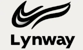

## Lynway WMS backend service

[Русская версия](README_ru.md)

This repository contains the **Community Edition (CE)** — the open-source backend of Lynway WMS, distributed under the **AGPLv3** license (see [LICENSE](LICENSE)).

The paid editions — **Business** and **Cloud** — are developed in a private repository and are not published on GitHub.

Swagger: http://localhost:8888/api/v1/docs/index.html

### Product editions

| Edition | Code | License | Location |
|---|---|---|---|
| Community Edition | open source | AGPLv3 | this repository |
| Business | closed source | commercial | private repository |
| Cloud | closed source | SaaS / commercial | private repository |

### How we develop without edition conflicts

1. **Shared core.** The CE repository is the source of truth for base logic. Business/Cloud are built on top of it as an overlay, not as a fork with separate branches.
2. **Private repo + synchronization.** The enterprise repository consumes CE code (submodule or allowlist-based sync script). Paid modules live only there and never end up on GitHub.
3. **Build tags.** Paid code is isolated with `//go:build enterprise`; such files are simply ignored by the compiler in CE builds. Extension points are interfaces and a registry: in CE the registry is empty.
4. **CI guarantee of CE purity.** CI in this repository builds and tests the binary **without** the `enterprise` tag — this prevents proprietary code from leaking into the open build.
5. **CLA.** CE contributors sign a Contributor License Agreement so we retain dual-licensing rights (ability to include their code in Business/Cloud).

### Deploy database for development

```
$ sudo docker compose up
```

This command will create a database in Docker.
