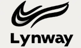

# Lynway WMS: сервис бэкенда (v1.0-alpha)

[English version](README.md)

**Легковесная система управления складом (WMS) для персонального хранения и малого бизнеса**.

Этот репозиторий содержит **Community Edition (CE)** — открытую версию бэкенда Lynway WMS, распространяемую под лицензией **AGPLv3** (см. [LICENSE](LICENSE)).

Платные редакции — **Business** и **Cloud** — разрабатываются в приватном репозитории и не публикуются на GitHub.

* **Swagger UI:** http://localhost:8888/api/v1/docs/index.html

---

## 🏗 Архитектура и Стек

* **Backend:** Go (`database/sql`, `lib/pq`, `golang-migrate` + `embed.FS`)
* **Database:** PostgreSQL 16 (`pg_trgm`, `JSONB`)
* **Клиенты (в разработке):**
    * **Android App:** сканирование QR/ШК, инспекция контейнеров, остатки и перемещения.
    * **Vue 3 SPA:** веб-интерфейс приемки, поиска и управления топологией.
    * **CUPS Print Agent:** локальный агент синхронизации принтеров и очереди печати.

---

## 🚀 Развёртывание для разработки

1. Клонируйте репозиторий и поднимите базу данных в Docker:
   ```bash
   sudo docker compose up -d
   ```
2. Запустите сервис (при первом старте БД инициализируется автоматически):
   ```bash
   go run ./cmd/server
   ```
   Учетная запись администратора по умолчанию: `admin` / `admin`.

---

## 📦 Редакции продукта

| Редакция | Код | Лицензия | Где находится |
| :--- | :--- | :--- | :--- |
| Community Edition | открытый | AGPLv3 | этот репозиторий |
| Business | закрытый | коммерческая | приватный репозиторий |
| Cloud | закрытый | SaaS / коммерческая | приватный репозиторий |

### Как устроена разработка без конфликтов между редакциями

1. **Общее ядро.** CE-репозиторий — источник истины для базовой логики. Business/Cloud собираются поверх него как надстройка, а не как форк с отдельными ветками.
2. **Приватный репозиторий + синхронизация.** Enterprise-репозиторий подключает код CE (submodule или скрипт-синхронизация с allowlist). Платные модули живут только там — в GitHub они не попадают.
3. **Build tags.** Коммерческий код изолируется тегом `//go:build enterprise`; в CE-сборке такие файлы просто игнорируются компилятором. Точки расширения — интерфейсы и registry: в CE регистрация пустая.
4. **CI-гарантия чистоты CE.** В этом репозитории CI собирает и тестирует бинарник **без** тега `enterprise` — так исключается утечка проприетарного кода в открытую сборку.
5. **CLA.** Контрибьюторы CE подписывают Contributor License Agreement, чтобы мы сохраняли право двойного лицензирования (закрывать их код в Business/Cloud).

---

## 🗺 Статус разработки (v1.0-alpha)

* [x] Проектирование архитектуры БД
* [x] Автоматическое создание БД, встроенные миграции
* [ ] Движок складских проводок (`storage`) и проверка запретов зон/ячеек
* [ ] Математика тар (`containers`: вложение, извлечение, инспекция до товаров)
* [ ] Сервис номенклатуры («Find, Clone or Create» + `pg_trgm`)
* [ ] REST API для Android-клиента, Vue 3 SPA и CUPS Print Agent
